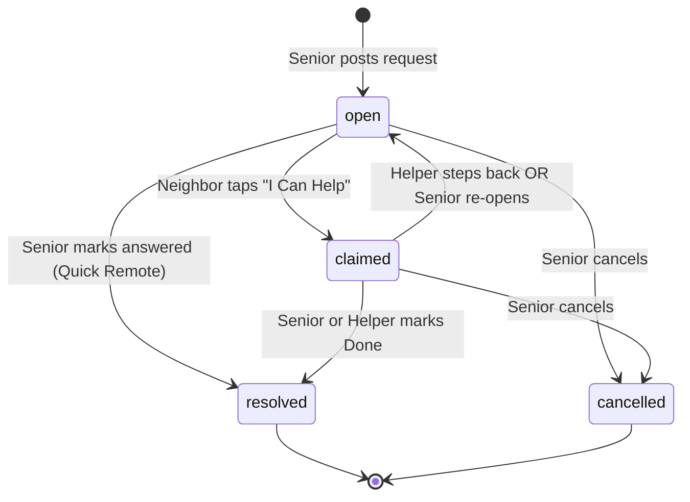

# Neighbor Help ("Lend a Hand") — Product & Technical Specification

Status: Draft · Target: v1 (inside `Share, Instead.`) · Model: Circle-verified, 100% Volunteer

---

## 1. Vision & Problem Statement

Everyday tasks that take a younger or tech-savvy neighbor 5 minutes can be stressful, isolating, or risky for seniors in the same apartment complex or neighborhood:

- **Phone & Digital:** Freeing up full phone storage, updating apps, recovering a locked bank/email account, checking whether an SMS/WhatsApp message is spam or a scam.
- **Home Tech:** Setting up Wi-Fi routers, CCTV cameras, Smart TVs, OTT apps, or printers.
- **Home & Handyman:** Changing a high bulb, fixing a loose hinge, moving a heavy box.
- **Errands & Rides:** Picking up medicines/groceries, a ride to a clinic or bank.

Today, seniors either hesitate to "bother" people, post in noisy WhatsApp groups where requests get buried, or call expensive/untrusted strangers.

**Core Principle:** *Ask a verified neighbor for help in 2 taps — big text, voice input, photo upload, zero jargon, zero money, and built-in safety guardrails.*

---

## 2. Design Decisions (Locked for v1)

| Dimension | Decision |
| --- | --- |
| **Product Home** | New feature inside **Share, Instead.**, reusing Firebase Auth, Circles (`circles`, `circle_members`), Profiles (`profiles`), and Chat (`messages`). |
| **Access & Trust** | **Invite-only / verified Circle members only.** Requests are never public; only members of the senior's Circle(s) can view or respond. |
| **Senior Interface** | Ultra-simple, senior-friendly web/mobile UI: large tap targets, high contrast, speech-to-text / voice input, and 1-tap photo/screenshot upload. |
| **Categories (v1)** | Broad from day 1: **Tech & Phone Help**, **Spam / Scam Check**, **Home & Handyman**, **Errands & Medicines**, **Rides**, and **Other**. |
| **Help Modes** | Explicit choice between **Quick Question / Screenshot** (remote) and **In-Person Visit** (with simple preferred time window). |
| **Matching** | **Community Help Board** inside the Circle — any verified neighbor can reply (for quick questions) or claim/offer to help (for visits/errands). |
| **Compensation** | **Strictly free / volunteer goodwill**, rewarded with 1-tap Thank-You notes and community karma (`helps_given`). |
| **Automation / AI** | **100% human-to-human for v1.** No automated AI verdicts; trust stays anchored in real neighbors. |

---

## 3. Why a Separate `help_requests` Model (Not `items`)

The existing `Share, Instead.` catalog (`items` + `requests`) is a **supply-first** model: an owner lists an item, and a borrower requests it.

Neighbor Help is **demand-first**:
1. A senior posts a *need* (not an asset they own).
2. Multiple neighbors may answer a quick question (e.g., *"Is this bank SMS a scam?"*), OR one neighbor claims an in-person task (e.g., *"Set up my Smart TV"*).
3. There is no "pickup" or "return" step — only **Open → Matched/Claimed → Done** (with a Thank-You).

Trying to overload `items` (as the legacy `neighbour-helping-neighbour` category did) forces seniors to fill out listing forms meant for lending objects. A dedicated `help_requests` collection keeps the UX effortless and the security rules clean.

---

## 4. User Personas & Core Journeys

### Personas
1. **Help Seeker (Primary: Senior Resident)** — Needs a calm, uncluttered screen, large readable fonts, voice input instead of tiny keyboards, and reassurance that only real neighbors in their Circle can see their request.
2. **Neighbor Helper** — Willing to spare 5–30 minutes for a neighbor; wants to see open requests in their Circle at a glance, answer quick screenshot questions inline, or tap "I can help!" to claim a visit.
3. **Circle Admin / RWA Moderator** — Ensures only verified residents are in the Circle; can remove inappropriate posts if needed.

### Journey A: Quick Remote Help (e.g., "Is this message a scam?")
1. Senior opens **Neighbor Help** → taps the big **"Ask for Help"** button.
2. Selects **"Spam / Scam Check"** (or **"Phone & Tech"**) → automatically defaults mode to **Quick Question / Screenshot** (toggleable).
3. Taps **"Add Screenshot / Photo"** to upload the suspicious SMS, and optionally taps the **Microphone** button to dictate: *"Got this message saying my electricity will be cut tonight, is it fake?"*
4. Taps **"Post to [My Circle]"**.
5. Neighbors in the Circle see the card with the screenshot. One or more neighbors post a quick reply (e.g., *"100% scam, Uncle! Please block and do not click the link."*).
6. Senior sees the reply, taps **"This Helped! Mark Done"**, and optionally sends a 1-tap **Thank You** note to the neighbor who helped.

### Journey B: In-Person Visit (e.g., "Set up CCTV / Smart TV / Bank Lockout")
1. Senior taps **"Ask for Help"** → selects **"Phone & Tech"** (or **"Home & Handyman"** / **"Errands"**).
2. Selects **"In-Person Visit"** and picks a simple time preference: *Today Morning*, *Today Evening*, *Tomorrow*, or *Anytime*.
3. Describes the issue via voice or text (no apartment/door number required on the public board).
4. A verified neighbor taps **"I Can Help"** → status moves to **Neighbor Offered** (`claimed`).
5. Senior gets a clear banner: *"Priya Sharma offered to help"* with two big buttons: **"Message Priya"** (opens existing `chat.html` pre-linked to this help request) and **"Mark Done"** once finished.
6. In private chat, they confirm the exact time and flat/door number.
7. After the visit, either party marks it **Done**, and the senior is prompted to send a **Thank You** (e.g., *"Thank you so much!"*, *"Lifesaver!"*, or custom note), incrementing Priya's `helps_given` karma.

---

## 5. Senior-First UX & Accessibility Standards

Every screen in the Neighbor Help flow MUST follow these rules:
- **Typography:** Minimum `18px` body text, `22px+` headings, high contrast (WCAG AAA target ≥ 7:1 where feasible).
- **Touch Targets:** Minimum `52px × 52px` for all primary buttons, category tiles, and actions. Never use icon-only buttons — always pair icons with plain-English text labels.
- **Input Friction Reduction:**
  - **Voice-to-Text (`SpeechRecognition` / `webkitSpeechRecognition`)** button right next to the description box, with graceful fallback if unsupported by the browser.
  - **1-Tap Photo / Screenshot Upload** (compressed client-side before upload, reusing existing image handling) for error screens, routers, or suspicious texts.
  - **Zero Required Dates/Forms:** Title is optional (auto-generated from category + first few words of description if omitted).
- **Plain-Language Status Bar:** Avoid technical states like `PENDING` or `CLAIMED`. Show:
  1. **Waiting for a neighbor** (`open`)
  2. **[Name] is helping** (`claimed`)
  3. **All Done!** (`resolved`)
- **Single-Column Calm Layout:** No dense multi-column grids or competing carousels on the Help page.

---

## 6. Trust & Safety Guardrails

Because seniors frequently ask for help with banking apps, passwords, or in-home setup, safety must be built into the UI copy without feeling scary:

1. **Circle-Only Visibility:** Every `help_request` MUST belong to a `circle_id`. Firestore rules enforce `exists(/databases/$(database)/documents/circle_members/$(circleId + '_' + request.auth.uid))` for all reads and writes.
2. **Contextual Safety Reminders:**
   - **Sensitive/Tech Tasks (`tech`, `spam_check`):** Show a warm amber callout box on both the senior's and helper's view:
     > *"Safety tip: Never share your bank OTP, ATM PIN, or passwords out loud. A good neighbor will guide you while you type it yourself."*
   - **In-Person Visits (`in_person`):** Show a reminder when posting:
     > *"Keep your flat/door number private here — share it only in private chat once you accept a neighbor's offer."*
3. **Easy Unclaim / Re-open:** If a helper claims a task and can no longer make it, they can tap **"Step Back / Re-open"** so the request immediately returns to `open` for another neighbor.
4. **Abuse / Flagging:** Senior or Circle Admin can cancel/delete a request at any time.

---

## 7. Lifecycle State Machine



### State Transition Rules

| From | To | Who Can Trigger | Side Effects |
| --- | --- | --- | --- |
| — | `open` | Any Circle member (requester) | Creates `help_requests/{id}` with `circle_id`, `requester_id`, `status: 'open'`. |
| `open` | `claimed` | Any *other* member of the same Circle | Sets `helper_id`, `helper_name`, `claimed_at`. (Atomic transaction to prevent two neighbors claiming simultaneously.) |
| `claimed` | `open` | `helper_id` OR `requester_id` | Clears `helper_id`, `helper_name`, `claimed_at`. |
| `open` / `claimed` | `resolved` | `requester_id` OR `helper_id` (if claimed) | Sets `resolved_at`, `resolved_by`. If `helper_id` (or selected helpful replier) is set, increments their `profiles/{uid}.helps_given` by 1. |
| `open` / `claimed` | `cancelled` | `requester_id` OR Circle creator | Sets `cancelled_at`. |

---

## 8. Data Model (Firestore)

### Collection: `help_requests/{requestId}`

```json
{
  "circle_id": "string (required, verified Circle)",
  "requester_id": "string (uid)",
  "requester_name": "string (denormalized)",
  "requester_avatar": "string | null",
  "category": "tech | spam_check | home_handyman | errands | rides | other",
  "help_mode": "remote | in_person",
  "preferred_time": "today_morning | today_evening | tomorrow | flexible | null",
  "title": "string (optional; auto-summarized if blank)",
  "description": "string (required, max 1000 chars)",
  "photo_urls": ["string (up to 3 compressed images/screenshots)"],
  "status": "open | claimed | resolved | cancelled",
  "helper_id": "string | null",
  "helper_name": "string | null",
  "helper_avatar": "string | null",
  "claimed_at": "timestamp | null",
  "resolved_at": "timestamp | null",
  "thank_you_note": "string | null",
  "thank_you_sent_at": "timestamp | null",
  "created_at": "timestamp",
  "updated_at": "timestamp"
}
```

### Subcollection: `help_requests/{requestId}/replies/{replyId}`
Used for **Quick Question / Screenshot** responses (e.g., neighbors confirming whether a message is spam, or asking a clarifying question before claiming an in-person visit).

```json
{
  "author_id": "string (uid)",
  "author_name": "string",
  "author_avatar": "string | null",
  "text": "string (max 1000 chars)",
  "is_marked_helpful": "boolean (default false, toggled by requester)",
  "created_at": "timestamp"
}
```

### Profile Additions (`profiles/{uid}`)
- `helps_given`: `number` (default `0`) — incremented atomically when a help request is resolved with this user as helper.
- `helps_received`: `number` (default `0`, optional/private).
- `thank_you_notes`: subcollection or latest notes displayed on helper's profile as a **"Helpful Neighbor"** section.

### Required Composite Indexes (`firestore/indexes.json`)
- `help_requests`: `(circle_id ASC, status ASC, created_at DESC)`
- `help_requests`: `(requester_id ASC, created_at DESC)`
- `help_requests`: `(helper_id ASC, status ASC, created_at DESC)`

---

## 9. Firestore Security Rules Outline

Aligned with existing `firestore.rules` conventions (`circle_members/{circleId}_{uid}`):

```javascript
function isCircleMember(circleId) {
  return request.auth != null
    && exists(/databases/$(database)/documents/circle_members/$(circleId + '_' + request.auth.uid));
}

match /help_requests/{requestId} {
  allow read: if isCircleMember(resource.data.circle_id);

  allow create: if request.auth != null
    && request.resource.data.requester_id == request.auth.uid
    && request.resource.data.status == 'open'
    && request.resource.data.helper_id == null
    && isCircleMember(request.resource.data.circle_id);

  allow update: if isCircleMember(resource.data.circle_id) && (
    // 1. Requester can edit details while open, reopen, resolve, cancel, or add thank_you_note
    resource.data.requester_id == request.auth.uid
    // 2. Another Circle member can claim an open request
    || (resource.data.status == 'open'
        && request.resource.data.status == 'claimed'
        && request.resource.data.helper_id == request.auth.uid
        && resource.data.requester_id != request.auth.uid
        && request.resource.data.diff(resource.data).affectedKeys()
             .hasOnly(['status', 'helper_id', 'helper_name', 'helper_avatar', 'claimed_at', 'updated_at']))
    // 3. Assigned helper can step back (reopen) or mark resolved
    || (resource.data.helper_id == request.auth.uid
        && request.resource.data.status in ['open', 'resolved']
        && request.resource.data.diff(resource.data).affectedKeys()
             .hasOnly(['status', 'helper_id', 'helper_name', 'helper_avatar', 'claimed_at', 'resolved_at', 'updated_at']))
  );

  allow delete: if request.auth != null && (
    resource.data.requester_id == request.auth.uid
    || get(/databases/$(database)/documents/circles/$(resource.data.circle_id)).data.created_by == request.auth.uid
  );

  match /replies/{replyId} {
    allow read: if isCircleMember(get(/databases/$(database)/documents/help_requests/$(requestId)).data.circle_id);
    allow create: if request.auth != null
      && request.resource.data.author_id == request.auth.uid
      && isCircleMember(get(/databases/$(database)/documents/help_requests/$(requestId)).data.circle_id);
    allow update: if request.auth != null
      && get(/databases/$(database)/documents/help_requests/$(requestId)).data.requester_id == request.auth.uid
      && request.resource.data.diff(resource.data).affectedKeys().hasOnly(['is_marked_helpful']);
    allow delete: if request.auth != null && resource.data.author_id == request.auth.uid;
  }
}
```
*(Plus extend `/profiles/{profileId}` update allow-list to permit incrementing `helps_given` by `+1` during resolution, mirroring `carbon_saved_kg`.)*

---

## 10. UI & Page Integration Plan (`site/public/`)

1. **`site/public/help.html` (New — Senior-Friendly Help Board & Ask Wizard):**
   - Prominent top button: **"Ask a Neighbor for Help"** (opens a clean 2-step full-screen wizard).
   - Simple tabs: **Open Requests** | **My Requests** | **I'm Helping**.
   - Filter chips by category (All, Phone & Tech, Spam Check, Home & Handyman, Errands, Rides) and mode (Quick Question vs. In-Person).
   - Large, clear cards showing requester photo/name, category badge, mode badge, description, thumbnail if photo attached, and 1-tap **"Answer"** / **"I Can Help"** button.
2. **`site/public/help-detail.html` (New — Request Detail & Resolution):**
   - Plain-language 3-step progress bar.
   - Full-size photo/screenshot viewer (pinch/tap to zoom for reading small SMS screenshots).
   - Contextual safety banner (for tech/spam/in-person).
   - Inline quick-replies thread (for remote answers) + **"Mark Helpful & Done"** button.
   - Direct **"Chat with [Neighbor]"** button linking to `chat.html?userId=<uid>&helpRequestId=<id>`.
   - 1-tap **Thank-You** modal on completion.
3. **Integration into Existing Pages:**
   - `circle-detail.html`: Add a **"Neighbor Help"** tab/section showing open help requests in that Circle + a **"Need a Hand?"** button.
   - `nav` (Header & BottomNavBar): Add **Help** entry point (or surface prominently from Home & Circles).
   - `profile.html`: Show **"Neighbors Helped (`helps_given`)"** badge and recent Thank-You notes.
   - `firebase-client.js`: Add `window.db.help` methods (`createHelpRequest`, `getCircleHelpRequests`, `claimHelpRequest`, `unclaimHelpRequest`, `resolveHelpRequest`, `addHelpReply`, `sendThankYou`).

---

## 11. Phased Rollout

- **Phase 1 (v1 MVP):** `help_requests` schema + Firestore rules + `help.html` (2-step wizard with speech-to-text & screenshot upload) + `help-detail.html` + Circle integration + Thank-You karma.
- **Phase 1.1 (Fast Follow):** Push/email/WhatsApp notification ping to Circle members when a senior posts a new request; audio voice-note recording (for seniors who prefer recording a 20-second clip over speech-to-text).
- **Phase 2 (Future):** Caregiver / Family Proxy mode (adult children can post or monitor requests for their parents), optional "Trusted Tech Helper" peer endorsements, and optional WhatsApp bot intake.

---

## 12. Success Metrics (Pilot in 1–2 Apartment Circles)

- **Time to First Response:** Median < 30 minutes for Quick Questions (spam checks), < 4 hours for In-Person claims.
- **Resolution Rate:** ≥ 80% of posted help requests marked `resolved` within 48 hours.
- **Senior Usability:** A senior can post a request (with voice or photo) in < 60 seconds without assistance.
- **Helper Repeat Rate:** ≥ 40% of helpers fulfill more than one request in the first month.
