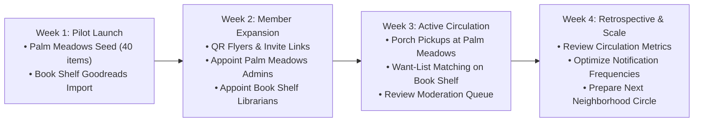

# NeighborGoods Initial Rollout Plan

## Executive Summary
This document outlines the initial operational rollout plan for **NeighborGoods** across two distinct pilot communities:
1. **Palm Meadows**: A localized **Neighborhood Circle** focused on physical goods sharing across all categories (power tools, lawn and garden equipment, kitchen appliances, camping gear, surplus, and books). Roles are centered around **Circle Admins** and **Community Members**.
2. **Book Shelf**: A dedicated **Universal Library Circle** focused exclusively on literature, canonical catalog curation, barcode scanning, Goodreads imports, edition deduplication, and reading circulation. Roles feature **Librarians** with catalog editing and moderation privileges alongside **Circle Admins**.

---

## 1. Dual Community Architecture Comparison

| Dimension | Palm Meadows (Neighborhood Circle) | Book Shelf (Universal Library Circle) |
| :--- | :--- | :--- |
| **Primary Focus** | General physical goods (tools, kitchen, lawn, gear, DIY) | Books, literary media, graphic novels, textbooks |
| **Key Governance Roles**| `Circle Admin` (Make Admin / Remove Admin), `Member` | `Circle Admin`, `Librarian` (Appoint Librarian), `Member` |
| **Catalog Structure** | Multi-category inventory (`kind: 'item'`, `'surplus'`) | Canonical books (`kind: 'book'`) linked to copies (`items`) |
| **Discovery & Search** | Radius distance sort, fuzzy category matching (Fuse.js) | Typesense semantic & typo-tolerant book search, ISBN lookup |
| **Supply Seeding Tool** | Mobile camera photo upload, rapid 30s item listing | Bulk Goodreads/CSV import, live barcode ISBN scanner |
| **Handoff Logistics** | Porch pickup, door drop, neighborhood clubhouse | Direct handoff, bookshelf drop box, book club swaps |

---

## 2. Palm Meadows Rollout Plan (Neighborhood Circle)

### 2.1 Objectives
- Establish a high-trust neighborhood commons where residents lend and borrow physical items instead of buying duplicates.
- Validate multi-category inventory discovery, pickup scheduling, and in-app neighborhood chat.
- Empower neighborhood leaders as **Circle Admins** to moderate membership and foster community culture.

### 2.2 Pre-Launch & Seeding (Days -7 to 0)
1. **Admin Setup & Circle Initialization**:
   - Create circle: **Palm Meadows Community Hub** (`circle_type: 'neighborhood'`).
   - Appoint 2–3 active neighborhood co-leads as **Admins** via the circle member modal (`Make Admin`).
   - Configure privacy setting: `Private Circle` (members request access or join via verified invite link).
2. **Seed Supply ("Pledge 2 Items")**:
   - Seed the initial inventory with 30–50 high-utility neighborhood items before inviting the broader community:
     - *Lawn & Garden*: Lawn mower, hedge trimmer, pressure washer, leaf blower, wheelbarrow.
     - *DIY & Tools*: Cordless drill, socket set, extension ladder, stud finder, circular saw.
     - *Kitchen & Hosting*: Stand mixer, ice cream maker, folding tables & chairs, fondue set.
     - *Outdoors & Kids*: 4-person camping tent, sleeping pads, board game bundles, bike pump.
   - Set item request policies: `circle_members` (standard) or `trusted_only` (for high-value power tools).

### 2.3 Member Acquisition & Onboarding (Week 1)
1. **Distribution Channels**:
   - **Neighborhood WhatsApp / Signal Group**: Post a short invite video with the circle link: `https://.../join-community.html?invite=[CODE]`.
   - **Clubhouse / Mailbox QR Flyers**: Physical flyers at the Palm Meadows community bulletin board with quick-scan QR codes leading to the circle preview page.
2. **First-Time User Experience (FTUE)**:
   - Visitors land on the view-only circle landing page, browse available inventory, and tap "Request to Join" or "Join Circle".
   - Admin receives notification and approves join requests with one tap in `circle-detail.html`.
   - New members receive an automated welcome post in the circle feed with simple borrowing etiquette.

### 2.4 Operations & Handoff Playbook (Weeks 2–4)
1. **Borrow Workflow**:
   - Borrower requests item with date range (`request-borrow.html`).
   - Lender confirms request; transaction advances to `approved`.
   - Transaction chat opens for contactless porch pickup coordination (exact address shared only after approval; street-level privacy preserved).
   - Both parties tap "Mark Picked Up" and "Confirm Return" to advance the verified lifecycle and record carbon/waste savings impact.
2. **Admin Moderation**:
   - Admins review circle transaction ledger (`circle-admin-ledger-panel`) for completed vs active shares.
   - Any broken item or conduct issue is handled through the built-in report queue (`reports`).

### 2.5 Key Success Metrics (Palm Meadows)
- **Activation**: ≥ 25 registered households by end of Week 2.
- **Supply Density**: ≥ 60 active listings across at least 4 categories.
- **Circulation Velocity**: ≥ 15 completed borrow transactions within 30 days.
- **Borrower Satisfaction**: ≥ 4.8 / 5.0 average transaction rating.

---

## 3. Book Shelf Rollout Plan (Universal Library Circle)

### 3.1 Objectives
- Launch a decentralized community library aggregating shared book collections.
- Empower community **Librarians** to curate canonical book records, merge duplicates, and audit condition grades.
- Enable frictionless book discovery using barcode scanning, ISBN enrichment, and Goodreads shelf import.

### 3.2 Pre-Launch & Catalog Bootstrap (Days -7 to 0)
1. **Librarian Team Onboarding**:
   - Circle Admin creates **Book Shelf** (`circle_type: 'library'`, `category: 'books'`).
   - Circle Creator appoints 2–3 avid readers or community volunteers as **Librarians** via the circle member modal (`Make Librarian`).
   - Librarians are briefed on metadata curation guidelines: ISBN verification, author canonical formatting, and condition grading standards.
2. **Catalog Seeding via Bulk Import & Scanning**:
   - Core team imports personal book collections using the CSV / Goodreads export tool (`Supply-Growth Tools`).
   - Run ISBN barcode scanner (`site/public/isbn-scanner.js`) at a local book club meetup to scan 100+ physical paperbacks and hardcovers in under 30 minutes.
   - Automated enrichment attaches high-resolution OpenLibrary covers, synopsis, publication year, and publisher metadata.

### 3.3 Public Rollout & Circulation (Weeks 1–3)
1. **Discovery & Want-List Matching**:
   - Promote **Book Shelf** to local book clubs, school reading groups, and neighborhood libraries.
   - Readers create **Want Lists** for titles they want to read next.
   - When any member adds a matching title, an automated notification fires: *"A copy of [Title] was just shared in Book Shelf!"*
2. **Search Experience**:
   - Typesense instant typo-tolerant search enabled for title, author, and genre queries (`searchBooksCatalog`).
   - Fallback to Firestore indexing ensures high availability even during network disruptions.
3. **Librarian Stewardship Workflows**:
   - **Duplicate Merging**: Librarians scan for duplicate book entries and merge them into canonical records (`mergeDuplicateBooks`), transparently re-pointing existing borrow requests and chat threads.
   - **Condition Auditing & Copy Withdrawal**: Damaged or lost copies are gracefully withdrawn from circulation with documented audit reasons (`withdrawItemCopy`).

### 3.4 Due Date Management & Return Hygiene (Weeks 3–6)
1. **Automated Reminders**:
   - 7 days before due date: Friendly reminder notification.
   - 2 days before due date: "Return preparation" notice.
   - Due date & overdue: Gentle escalation alerts and borrower prompts.
2. **Community Reading Challenges**:
   - Monthly circle leaderboards showcasing active borrowers, top lenders, and carbon/paper saved.

### 3.5 Key Success Metrics (Book Shelf)
- **Catalog Breadth**: ≥ 300 unique canonical book titles cataloged by Week 3.
- **Supply Diversity**: ≥ 5 distinct literary genres represented (fiction, non-fiction, sci-fi, children's, biography).
- **Circulation**: ≥ 25 concurrent active book loans.
- **Want-List Fulfillment**: ≥ 25% of submitted want lists fulfilled within 30 days.

---

## 4. Rollout Timeline & Phased Milestone Gate

### Milestone Review Gates
| Gate | Verification Criteria | Action if Not Met |
| :--- | :--- | :--- |
| **Palm Meadows Supply Gate** (Day 7) | At least 35 items listed across tools, kitchen, and lawn. | Host in-person Saturday "Coffee & Tool Cataloging" table. |
| **Palm Meadows First Share Gate** (Day 14) | At least 5 borrow transactions completed successfully. | Feature high-demand seasonal items (e.g., pressure washer, lawn aerator) in weekly feed post. |
| **Book Shelf Catalog Gate** (Day 7) | At least 150 canonical books in catalog with cover images. | Assist library volunteers with Goodreads CSV bulk upload tool. |
| **Book Shelf Circulation Gate** (Day 14) | At least 10 active book requests in flight. | Broadcast popular book club picks to circle feed with direct borrow links. |

---

## 5. Risk Management & Safety Controls

1. **Member Accountability & Trust**:
   - `request_policy: 'trusted_only'` allows lenders to restrict high-value items (e.g. expensive power tools) to known neighbors.
   - Verified ratings and transaction counts are displayed on user profiles.
2. **Location Privacy**:
   - Raw GPS coordinates and full street addresses are never publicly visible on circle inventory.
   - Exact pickup details are only shared within private transaction chats after a lender approves a request.
3. **Damage & Loss Resolution**:
   - In-app transaction resolution flow allows members to submit dispute reports with photo evidence.
   - Circle Admins have immediate access to review reported items and take moderation actions.
4. **Platform Infrastructure Resilience**:
   - Feature flags (`global_catalog_public`, `typesense_search`) permit instant rollback if unexpected errors occur.
   - Synthetic load benchmark validated at 25,000 ops/sec with 0% error rate.
